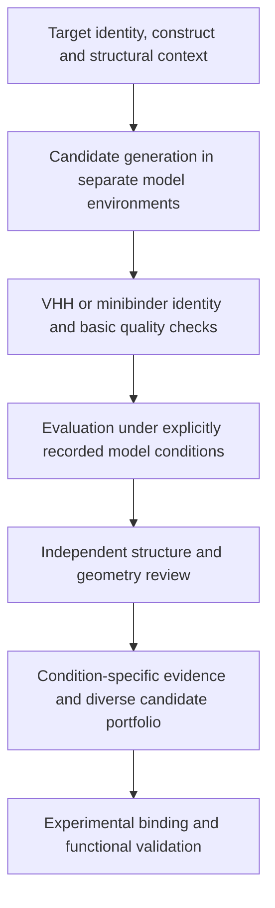

# Protein Design Evidence

**A research project for traceable evaluation of AI-designed nanobodies and minibinders.**

[中文介绍](README.zh-CN.md) · [Research status](docs/research-status.md) · [Workflow](docs/workflow.md) · [Source provenance](docs/source-provenance.json)

Protein design produces candidate sequences, structures and confidence scores. This project develops a workflow that links those outputs to their exact inputs and evaluation conditions, and checks whether a promising score is supported by coherent structural evidence.

The broader research workflow has investigated NK2R-directed nanobody candidates and is evaluating approaches for the Changjiang Cup nanobody/minibinder challenge. The public repository contains selected, working audit utilities from that workflow, together with a CPU-only synthetic demonstration. It is a public technical project record, not a release of the entire private research pipeline.

## What this repository contains

| Component | Purpose | Status |
| --- | --- | --- |
| `pdp/common.py` | File/object hashes and JSON utilities | Existing project code, published unchanged |
| `pdp/metrics.py` | Direction-specific cross-chain PAE and binder confidence summaries | Existing project code, published unchanged |
| `pdp/interface_robustness.py` | Separate target deformation, binder pose and binder shape RMSD | Existing project code, published unchanged |
| `examples/audit_demo.py` | Demonstrate why a well-folded binder can still move relative to its target | Runnable synthetic example |
| `tests/` | Confidence-array validation and coordinate-scope checks | Run with Python unittest |
| `docs/` | Research scope, model roles, limitations and provenance | Public documentation |

The provenance manifest records SHA256 hashes of the extracted source modules. Example coordinates and confidence values are synthetic; they are not experimental results or competition candidates.

## Quick start

Python 3.10+ and NumPy are sufficient. No GPU, model weights, API keys or network access are needed to run the example once NumPy is available.

```bash
python -m venv .venv
source .venv/bin/activate
python -m pip install -r requirements.txt
python -m unittest discover -s tests -v
python -m examples.audit_demo
```

The demo prints a JSON report. A rigid displacement preserves binder shape while changing its pose relative to the receptor. Reporting those quantities separately prevents a single global RMSD from obscuring the distinction.

`prediction_blocks` expects a residue-level PAE matrix in angstroms and **ColabDesign-style pLDDT normalized to [0, 1]**. It is not a universal model-output parser and does not implement ipSAE.

## Research workflow



Models such as BoltzGen generate candidates; structure predictors provide evidence under specified input conditions. Competition-specific evaluation profiles must be kept separate. Planned ESMFold2/ipSAE adaptation is documented as future work and is **not implemented in this public snapshot**.

## Current scientific limits

- No experimental binding or agonist activity is established by this repository.
- The broader NK2R work produced computational candidates; structural agreement does not establish receptor activation.
- Model confidence, geometry checks, competition eligibility and wet-lab success are different claims.
- Selected utilities are provided here; model execution, full candidate selection, private data and experimental infrastructure are outside this release.

## Collaboration and use of AI assistants

The project uses AI assistants for literature synthesis, protocol drafting, code development, debugging and communication. Scientific acceptance criteria, provenance checks and experimental interpretation require explicit review. No API credentials or research sequences are included here.

Project scope: computational protein design, reproducibility and research software. Publication of this repository does not imply endorsement by a competition organizer or service provider.

## References

- [BoltzGen](https://github.com/HannesStark/boltzgen)
- [RFantibody](https://github.com/RosettaCommons/RFantibody)
- [ESMFold2 model card](https://huggingface.co/biohub/ESMFold2)
- [ipSAE](https://github.com/DunbrackLab/IPSAE)
- [Tsinghua PDC2026](https://www.fbs.frcbs.tsinghua.edu.cn/competition/PDC2026)
- [Changjiang Cup](https://aiprotein.sjtu.edu.cn/)

## Rights

This is a public, source-visible project snapshot. No open-source license is granted by this release; rights are retained by the respective authors. Third-party code and model weights are not redistributed. Upstream tools have their own licenses and access terms.

Public snapshot: **2026-11-04**.
